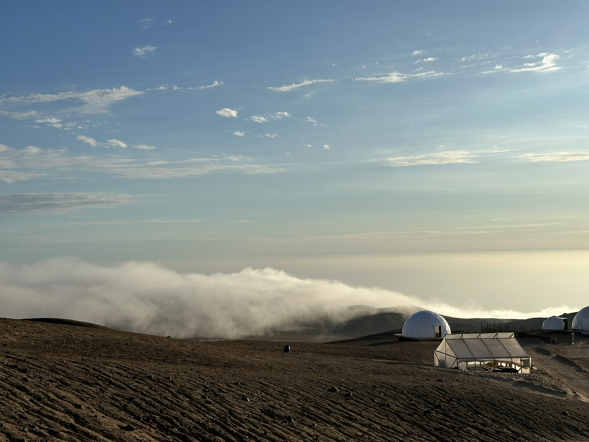

## Establishing hydroponic crops using fog water

Meet the locations in the Atacama Desert where we have been working with hydroponic crops and fog water:

### Alto Patache, Iquique

Atacama UC Station, part of UC Regional Centers 

::: {.columns}

::: {.column width="50%"}

:::

::: {.column width="50%"}

:::

:::

### Falda Verde, Chañaral
