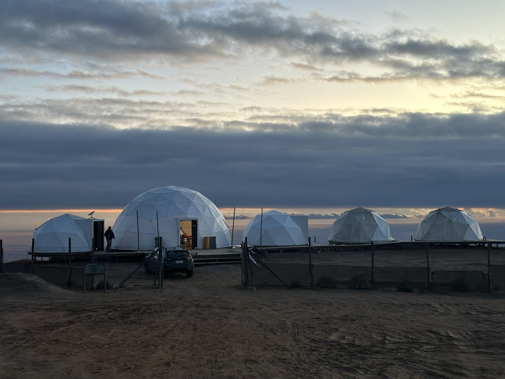

Meet the locations in the Atacama Desert where we have been working with hydroponic crops and fog water:

Atacama UC Station, part of UC Regional Centers 

::: {#fig-patache layout-nrow="1" layout-valign="center"}

:::

## Establishing hydroponic crops using fog water
## Alto Patache, Iquique

## Falda Verde, Chañaral 
